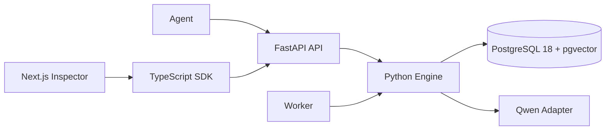

# Memrise

`Memrise` is a lightweight temporal hybrid memory framework for AI agents. It stores experience as immutable episodes, consolidates durable knowledge into versioned memories, projects accepted memories into a temporal graph, retrieves with lexical/semantic/graph signals, and learns from retrieval outcomes.

It is not a chat app, a multi-agent system, or a GraphRAG product. PostgreSQL is the source of truth for episodes, canonical memories, embeddings, full-text search, graph claims, graph projection, retrieval traces, feedback, and jobs.

## Architecture

The diagram below is the target memory lifecycle. Agents reach it through the HTTP API and TypeScript SDK (the **Memory Gateway** in the diagram).


| Diagram section      | What it maps to in this repo                                                                                                                                                                   | Status                                                                                                          |
| -------------------- | ---------------------------------------------------------------------------------------------------------------------------------------------------------------------------------------------- | --------------------------------------------------------------------------------------------------------------- |
| Memory write path    | `capture` / `remember` → `WriteService` → importance gate → Qwen extraction → reconciliation → canonical memory versions → graph claims → Apache AGE projection                                | Implemented                                                                                                     |
| Memory read path     | `retrieve` → scope/lifecycle filters → lexical, semantic, graph, and critical lookup → reciprocal rank fusion → usefulness/confidence ranking → token-budget context packing → retrieval trace | Implemented                                                                                                     |
| Memory consolidation | `consolidate` job → `SessionConsolidationService`                                                                                                                                              | Partial: replays extraction for session episodes; merge/compress/resolve steps in the diagram are not wired yet |
| Outcome learning     | `feedback` → usefulness score updates on memories and graph edges                                                                                                                              | Implemented; never mutates factual content or confidence                                                        |

Graph writes are **claims-first**: accepted relations are persisted in PostgreSQL (`graph_entities`, `graph_claims`) and projected into the temporal graph store. Retrieval can seed graph traversal from persisted entities.

## Deployment



## Why Not Basic Vector Memory

Basic vector memory usually stores mutable chunks and retrieves nearest neighbors. `Memrise` separates immutable episodes from versioned canonical memories, preserves superseded history, uses exact lexical lookup for identifiers, reserves room for critical constraints, and updates usefulness from outcomes without changing factual truth.

## Paths

Write path: capture experience → immutable episodes → importance gate → extract candidate memories → reconcile (add, reinforce, new version, contest, or ignore) → canonical memory version → embedding/search document → graph claims → temporal graph projection.

Read path: scope and lifecycle filter → critical lookup, structured match, lexical search, semantic search, and graph expansion → candidate fusion (RRF) → validity filter → utility-aware ranking → context packer → retrieval trace.

Consolidation: worker jobs replay session extraction today; fuller merge, relationship update, and stale-memory handling in the architecture diagram are planned.

Outcome learning: helpful, unused, or harmful feedback adjusts usefulness scores only. It never changes factual content, truth confidence, lifecycle status, or validity intervals.

## Quick Start

```bash
make bootstrap
docker compose -f infra/compose.yaml up -d postgres
make migrate
make dev
```

API: `http://localhost:8000`  
Inspector: `http://localhost:3000`

## Python Example

```python
from memrise import Memrise

memory = Memrise.from_env()
await memory.capture(
    namespace_id="local",
    agent_id="coding-agent",
    session_id="session-1",
    user_id="user-1",
    project_id="atlas",
    events=[{"kind": "user_message", "content": "Atlas uses pnpm.", "metadata": {}}],
)
```

## TypeScript Example

```ts
import { MemriseClient } from "memrise-memory-sdk";

const memory = new MemriseClient({
  baseUrl: process.env.MEMRISE_API_URL!,
  apiKey: process.env.MEMRISE_API_KEY!,
});

await memory.retrieve({
  namespaceId: "local",
  agent_id: "coding-agent",
  project_id: "atlas",
  query: "How should I install dependencies for Atlas?",
  token_budget: 800,
  limit: 10,
});
```

## Development

`make bootstrap` installs dependencies and configures Git to use `.githooks/`.
Run `make install-hooks` if hooks need to be reinstalled.

Run `make format` to apply Ruff and Prettier formatting. Run `make check` for local static checks and unit/contract tests. Run `make test-integration` after PostgreSQL is up and migrated. Generated files are `contracts/openapi.json` and `packages/sdk-typescript/src/generated/api-types.ts`; refresh them with `make generate-sdk`.

The pre-commit hook runs staged-file-aware Ruff, Prettier, ESLint/typecheck checks, plus a legacy-name scan. The commit-msg hook enforces Conventional Commit subjects and blocks old product/package names.

## Repository Map

- `docs`: architecture diagrams and design references.
- `infra`: Docker Compose stack, Dockerfiles, and PostgreSQL extension bootstrap.
- `packages/engine`: Python core models, ports, integrations, services, Alembic migration.
- `apps/api`: FastAPI HTTP translation layer.
- `apps/worker`: PostgreSQL-backed worker.
- `packages/sdk-typescript` (`memrise-memory-sdk`): fetch-based SDK generated from OpenAPI types.
- `apps/web`: Next.js inspector.

## Current Limitations

- Consolidation handlers are skeletal beyond extraction jobs.
- Capture, remember, and retrieval require a configured Qwen API key. The repository no longer ships an in-app model fallback.
- Qwen prompts are initial versions and need eval-driven refinement.
- Authorization is a simple API key, intentionally not production-grade multi-tenant auth.
- The inspector is a minimal data inspection tool, not a polished product UI.

Apache-2.0.
