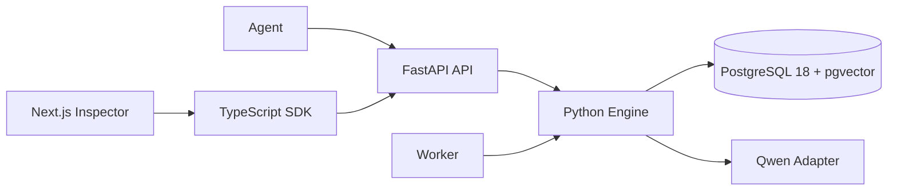

# Memrise

`Memrise` is a lightweight temporal hybrid memory framework for AI agents. It stores experience as immutable episodes, consolidates durable knowledge into versioned memories, projects accepted memories into a temporal graph, retrieves with lexical/semantic/graph signals, and learns from retrieval outcomes.

It is not a chat app, a multi-agent system, or a GraphRAG product. PostgreSQL is the source of truth for episodes, canonical memories, embeddings, full-text search, graph projection, retrieval traces, feedback, and jobs.



## Why Not Basic Vector Memory

Basic vector memory usually stores mutable chunks and retrieves nearest neighbors. `Memrise` separates immutable episodes from versioned canonical memories, preserves superseded history, uses exact lexical lookup for identifiers, reserves room for critical constraints, and updates usefulness from outcomes without changing factual truth.

## Paths

Write path: episode -> candidate extraction -> deterministic reconciliation -> accepted memory version -> embedding/search document -> graph projection.

Read path: critical lookup -> structured, lexical, semantic, and graph retrieval -> reciprocal rank fusion -> usefulness/confidence/scope adjustments -> context packing -> retrieval trace.

Consolidation: worker jobs merge repeated evidence, resolve corrections, keep scopes separate, preserve source episode IDs, and update graph edges only from accepted memory changes.

Outcome learning: helpful/unused/harmful feedback adjusts usefulness scores only. It never changes factual content, truth confidence, lifecycle status, or validity intervals.

## Quick Start

```bash
make bootstrap
docker compose up -d postgres
make migrate
make seed
make dev
```

API: `http://localhost:8000`  
Inspector: `http://localhost:3000`

## Python Example

```python
from memrise import Memory

memory = Memory.from_env()
await memory.capture(
    namespace_id="demo",
    agent_id="coding-agent",
    session_id="session-1",
    user_id="user-1",
    project_id="atlas",
    events=[{"kind": "user_message", "content": "Atlas uses pnpm.", "metadata": {}}],
)
```

## TypeScript Example

```ts
import { MemoryClient } from "@memrise/sdk";

const memory = new MemoryClient({
  baseUrl: process.env.MEMRISE_API_URL!,
  apiKey: process.env.MEMRISE_API_KEY!,
});

await memory.retrieve({
  namespace_id: "demo",
  agent_id: "coding-agent",
  project_id: "atlas",
  query: "How should I install dependencies for Atlas?",
  token_budget: 800,
  limit: 10,
});
```

## Development

`make bootstrap` installs dependencies and configures Git to use `.githooks/`.
Run `make install-hooks` if hooks need to be reinstalled.

Run `make format` to apply Ruff and Prettier formatting. Run `make check` for local static checks and unit/contract tests. Run `make test-integration` after PostgreSQL is up and migrated. Generated files are `docs/openapi.json` and `packages/sdk-typescript/src/generated/api-types.ts`; refresh them with `make generate-sdk`.

The pre-commit hook runs staged-file-aware Ruff, Prettier, ESLint/typecheck checks, plus a legacy-name scan. The commit-msg hook enforces Conventional Commit subjects and blocks old product/package names.

## Repository Map

- `packages/engine`: Python core models, ports, integrations, services, Alembic migration.
- `apps/api`: FastAPI HTTP translation layer.
- `apps/worker`: PostgreSQL-backed worker.
- `packages/sdk-typescript` (`@memrise/sdk`): fetch-based SDK generated from OpenAPI types.
- `apps/web`: Next.js inspector.
- `packages/evals`: local evaluation fixtures and pure metrics.

## Current Limitations

- Consolidation handlers are skeletal beyond extraction jobs.
- Semantic retrieval uses deterministic embeddings in local/test mode.
- Qwen prompts are initial versions and need eval-driven refinement.
- Authorization is a simple API key, intentionally not production-grade multi-tenant auth.
- The inspector is a minimal data inspection tool, not a polished product UI.

Apache-2.0.
