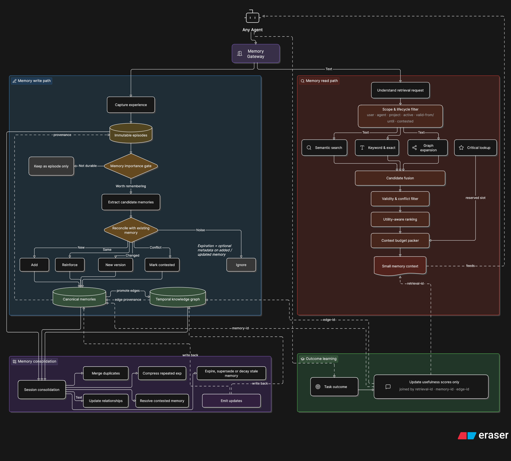
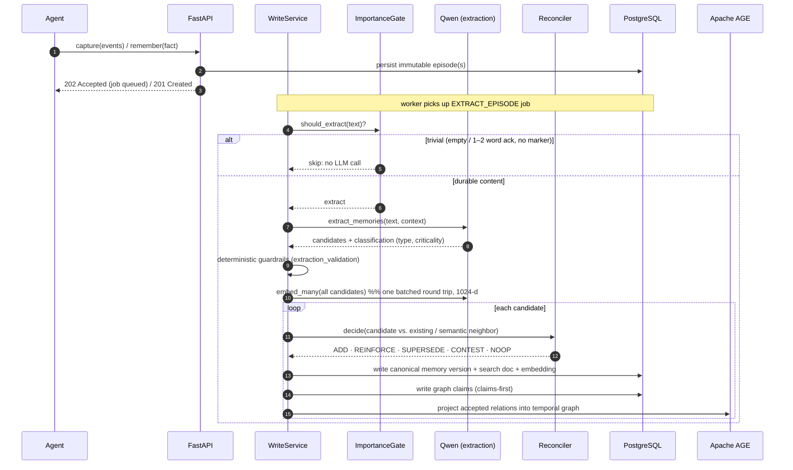
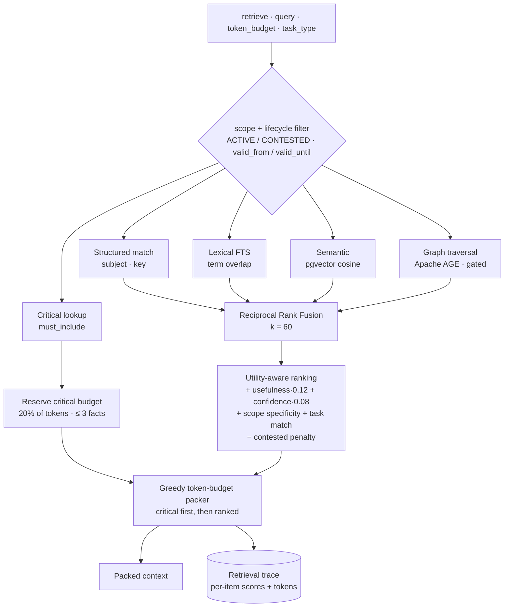
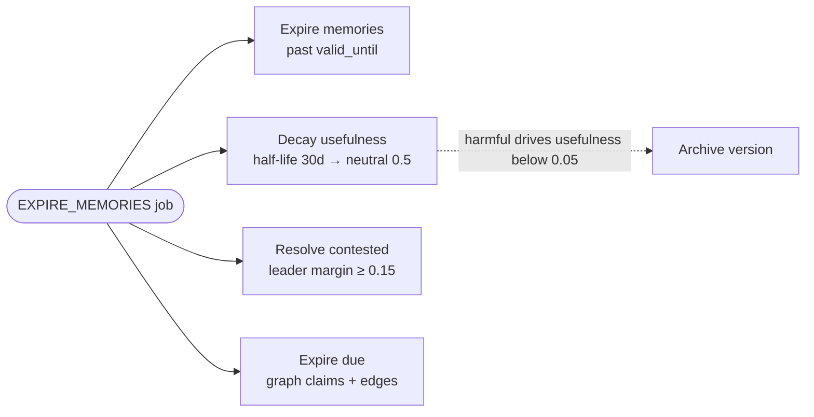
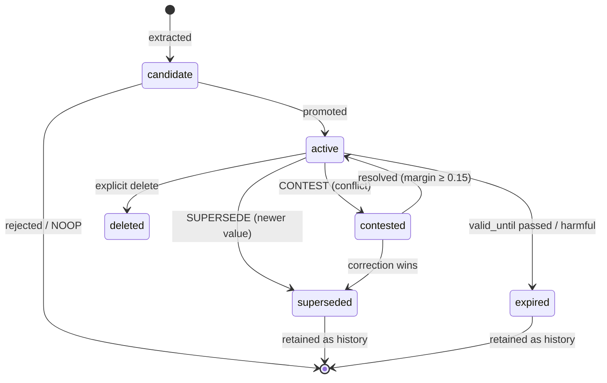

# Memrise

**Memrise is a temporal, hybrid memory engine for AI agents.** It lets an agent autonomously accumulate experience, remember user preferences, forget what has gone stale, and recall the critical facts even inside a tight context window, across many turns and many sessions.

It stores experience as **immutable episodes**, consolidates durable knowledge into **versioned canonical memories**, projects accepted memories into a **temporal knowledge graph**, retrieves with **lexical + semantic + graph** signals fused together, and **learns from retrieval outcomes** without ever rewriting the truth it stored.

**PostgreSQL is the single source of truth** for episodes, canonical memories, embeddings, full-text search, graph claims, graph projection, retrieval traces, feedback, and background jobs.

---

## Table of contents

- [The problem this solves](#the-problem-this-solves)
- [System architecture](#system-architecture)
- [Models used for inference and embedding](#models-used-for-inference-and-embedding)
- [The write path: accumulating experience](#the-write-path-accumulating-experience)
- [The read path: recall under a context budget](#the-read-path-recall-under-a-context-budget)
- [Forgetting: keeping memory sharp over time](#forgetting-keeping-memory-sharp-over-time)
- [Outcome learning](#outcome-learning)
- [Deduplication and consolidation](#deduplication-and-consolidation)
- [Memory lifecycle](#memory-lifecycle)
- [Data model](#data-model)
- [API & SDK surface](#api--sdk-surface)
- [Quick start](#quick-start)
- [Repository map](#repository-map)
- [Development](#development)
- [Current limitations](#current-limitations)

---

## The problem this solves

An agent needs to "autonomously accumulate experience, remember user preferences, and make increasingly accurate decisions across multi-turn, cross-session interactions" — which comes down to **efficient storage and retrieval**, **timely forgetting of outdated information**, and **recalling critical memories within limited context windows**.

Memrise maps each of those to a concrete mechanism:

| Focus                                      | How Memrise implements it                                                                                                                                                                                                                                                  |
| ------------------------------------------ | -------------------------------------------------------------------------------------------------------------------------------------------------------------------------------------------------------------------------------------------------------------------------- |
| **Efficient storage & retrieval**          | Immutable episodes vs. versioned canonical memories; three retrieval channels (exact-lexical FTS, semantic pgvector, temporal graph) fused with Reciprocal Rank Fusion; per-channel candidate caps so cost is bounded.                                                     |
| **Timely forgetting**                      | A background lifecycle job that expires memories past their validity interval, **decays usefulness on a 30-day half-life toward neutral**, resolves contested pairs, and supersedes facts through temporal reconciliation, history is preserved, never physically deleted. |
| **Recall within a limited context window** | A **critical-memory reservation** (20% of the token budget, up to 3 `must_include` facts, packed first) plus a greedy token-budget packer and utility-aware ranking, so the constraints that matter survive even a small budget.                                           |

---

## System architecture

Agents talk to Memrise only through the **HTTP API** and the **TypeScript SDK**, never to PostgreSQL directly. The Python engine owns all memory logic; the worker runs background jobs; PostgreSQL (with pgvector + Apache AGE) is the source of truth; Qwen models provide extraction, consolidation, answering, duplicate judging, and embeddings.

The diagram below is the target memory lifecycle; agents reach it through the Memory Gateway (the HTTP API + SDK).



---

## Models used for inference and embedding

All model access goes through the **Qwen adapter** (`packages/engine/src/memrise/integrations/qwen`), which speaks to **Alibaba Cloud DashScope** over its OpenAI-compatible endpoint. There is intentionally **no in-app model fallback**, capture, remember, retrieve, and respond require a configured API key.

| Purpose                                | Default model       | Config (env)           | Notes                                                                                                                                                                                  |
| -------------------------------------- | ------------------- | ---------------------- | -------------------------------------------------------------------------------------------------------------------------------------------------------------------------------------- |
| **Memory extraction & classification** | `qwen3.6-flash`     | `QWEN_MEMORY_MODEL`    | Reads episode text, proposes candidate memories with type + criticality, emits validated JSON (`memory_extraction_v1` prompt).                                                         |
| **Session consolidation**              | `qwen3.6-flash`     | `QWEN_MEMORY_MODEL`    | Replays a session's episodes to consolidate durable knowledge (`consolidation_v1` prompt).                                                                                             |
| **Agent answer generation**            | `qwen3.6-flash`     | `QWEN_MEMORY_MODEL`    | `POST /v1/agent/respond`: answers a query grounded in retrieved memories (`agent_answer_v1` prompt).                                                                                   |
| **Duplicate equivalence judge**        | `qwen3.6-flash`     | `QWEN_MEMORY_MODEL`    | Decides whether two ambiguous memories state the same thing when embeddings can't (`duplicate_judge_v1` prompt).                                                                       |
| **Embeddings**                         | `text-embedding-v4` | `QWEN_EMBEDDING_MODEL` | **1024 dimensions** (`QWEN_EMBEDDING_DIMENSIONS`), stored in a pgvector column and used for the semantic retrieval channel. Batched on the write path and cached for repeated queries. |

Connection is configured with `ALIBABA_CLOUD_API_KEY` and `ALIBABA_CLOUD_BASE_URL`; calls use a 30s timeout (`QWEN_TIMEOUT_SECONDS`) and up to 2 retries (`QWEN_MAX_RETRIES`). Every stored memory version records the `embedding_model` and the extraction `model_name` / `prompt_version` for provenance.

---

## The write path: accumulating experience

An agent submits experience with `capture` (raw events, processed asynchronously) or `remember` (a direct fact). Both flow through the same pipeline: a cheap importance gate, LLM extraction + classification, deterministic validation, and **temporal reconciliation** against what is already known.



Candidate embeddings are computed in a single batched provider call (`embed_many`), not one request per candidate, so extraction jobs drain faster.

**Importance gate** (`write/importance.py`): a recall-oriented pre-filter, not the precision layer. It only skips content that cannot hold durable knowledge (empty text, one- or two-word acknowledgements), while rescue markers like `always`, `never`, `must`, `use`, `prefer`, `decision`, `constraint` keep short imperatives ("use pnpm") in play. Everything else is handed to the LLM classifier to accept or reject.

**Reconciliation** (`learning/reconciliation.py`) is what makes memory temporal instead of append-only. Comparing a new candidate against the existing active memory yields one operation:

- **ADD**: no related memory exists yet.
- **REINFORCE**: same value again; adds evidence / confidence.
- **SUPERSEDE**: a newer value replaces an older one (driven by temporal cues like "used to", "now instead of", "no longer", "switched from", "corrected"). The old version is retained as `superseded`, never deleted.
- **CONTEST**: a conflicting value arrives; both sides stay retrievable, ranked below settled facts, until resolved.
- **NOOP**: provider marked the candidate as noise.

Reconciliation is keyed on a memory's `subject`/`key`, so it would miss a restatement phrased under a different subject. To prevent that, the write path also runs a **scope-wide semantic nearest-neighbor check**: if a plain candidate is near-identical (by cosine) to an existing memory under a different subject/key, it reinforces that memory instead of creating a duplicate. Corrections and provider-flagged conflicts are exempt so they keep their own identity.

**Claims-first graph writes**: accepted relations are persisted in PostgreSQL (`graph_entities`, `graph_claims`) and then projected into the Apache AGE temporal graph. Graph edges are always projections of accepted memory versions, never written from raw episodes.

---

## The read path: recall under a context budget

`retrieve` takes a query, a **token budget**, an optional `task_type`, and a `limit`. It gathers **bounded** candidate sets from up to five channels, fuses them, ranks by utility, **reserves budget for critical memories**, and packs the final context, writing a full retrieval trace for every decision.

Two properties keep it fast under load. **Candidate generation is bounded and SQL-side**: each channel returns a capped result set (lexical/semantic/structured top ~50, critical top ~20, graph by traversed paths), so Python only ever ranks a few hundred candidates regardless of how many memories the scope holds, no full-scope scan. The independent channels run **concurrently** (`asyncio.gather`, each on its own database session), and the query embedding is served from a **bounded LRU cache** so repeated or near-identical queries skip a provider round trip.



**Channels** (`read/retrieval.py`)

| Channel               | Technology                                                                                             | Retrieval role                                                                                                                             |
| --------------------- | ------------------------------------------------------------------------------------------------------ | ------------------------------------------------------------------------------------------------------------------------------------------ |
| **Critical lookup**   | Bounded SQL query over active `must_include` memories                                                  | Reserves space for non-negotiable constraints even when query overlap is weak.                                                             |
| **Structured match**  | Bounded SQL `LIKE` over normalized `subject` and `key`                                                 | Finds identifier-like memories before looser text matching.                                                                                |
| **Lexical / keyword** | PostgreSQL full-text search: generated `tsvector`, `websearch_to_tsquery`, `ts_rank`, GIN index        | Finds exact words and phrases such as names, flags, versions, and package names.                                                           |
| **Semantic**          | Qwen `text-embedding-v4` embeddings, 1024 dimensions, stored in pgvector with HNSW `vector_cosine_ops` | Finds memories with similar meaning; retrieval orders by cosine distance and converts distance into similarity.                            |
| **Graph**             | Apache AGE inside PostgreSQL, projected from accepted graph claims                                     | Finds related facts through entity/relation traversal; runs only when graph retrieval is useful and available, with clamped 1-2 hop paths. |

The channels are intentionally different: keyword finds the same words, semantic finds similar meaning, and graph finds related facts connected through entities and relations.

**Reciprocal Rank Fusion** (`RRF_K = 60`) combines the ranked channel outputs without needing to normalize incomparable score scales. Memrise does not average raw lexical, semantic, and graph scores directly; each channel contributes by rank:

```text
rrf_score(memory) = sum(1 / (60 + channel_rank))
```

**Utility-aware ranking** then adds memory-quality signals on top of the fused retrieval score:

```text
final_score =
  rrf_score
  + usefulness_score * 0.12
  + confidence * 0.08
  + scope_specificity
  + task_match_boost
  - contested_penalty
```

`scope_specificity` gives user-scoped memories `+0.05` and project-scoped memories `+0.08`; `task_match_boost` is `+0.05`; `contested_penalty` is `−0.04`. Outcome feedback changes usefulness only, so helpful memories rise in future ranking without rewriting their factual content.

**Critical reservation + packing** is the answer to "recall critical memories within a limited context window." Before normal results are packed, `_select_critical` reserves **20% of the token budget** (`token_budget × 0.2`) for up to **3** `must_include` memories, ranked by query relevance. The greedy packer then emits **critical first**, then ranked normal memories, stopping at the budget. So even at a tiny budget, the non-negotiable constraints make it into context.

Every retrieval persists a **trace** with each candidate's lexical/semantic/graph scores, usefulness, final rank, token count, and whether it was selected, the basis for both debugging and outcome learning.

---

## Forgetting: keeping memory sharp over time

Timely forgetting runs as the idempotent **`EXPIRE_MEMORIES`** background job (`learning/lifecycle.py`). Every step is safe to repeat and never physically deletes normal history.



- **Validity expiry**: memories with a `valid_until` in the past move to `expired` but remain queryable as history.
- **Usefulness decay**: usefulness relaxes toward the neutral `0.5` on a **30-day half-life**: `factor = 0.5 ^ (elapsed / half_life)`. A memory must keep earning its rank through use, or it quietly fades in the ranking. Rows touched within the last 24h are skipped so decay runs are cheap no-ops.
- **Contested resolution**: a contested pair settles once one side leads by a combined usefulness+confidence margin of `0.15`.
- **Harmful archival**: feedback that drives usefulness to `≤ 0.05` expires the version outright.
- **Graph hygiene**: due claims and projected edges expire alongside their memories.

The result: outdated facts stop winning retrieval **without** losing the audit trail of what the agent once believed and why it changed.

---

## Outcome learning

After using retrieved context, an agent reports an outcome via `feedback`: **helpful**, **unused**, or **harmful**. This adjusts the **usefulness score only** on the memories (and graph edges) involved. It **never** changes factual content, truth confidence, lifecycle status, or validity intervals. Over many sessions, memories that repeatedly help rise; those that mislead sink and can be archived, which is how decisions get "increasingly accurate" without corrupting stored truth.

---

## Deduplication and consolidation

The same fact often arrives phrased many ways across turns and sessions ("Atlas switched to pnpm", "Atlas migrated its package manager to pnpm"). Reconciliation catches restatements under the same `subject`/`key`; everything else is handled by a layered dedup system so recall stays clean without ever losing information.

1. **Write-time prevention** (synchronous): a scope-wide embedding nearest-neighbor at write time reinforces an existing memory instead of storing a near-identical restatement (see the write path).
2. **Embedding merge** (periodic `DEDUPE_MEMORIES` job): clusters same-scope active memories by cosine similarity (single-linkage, so a chain of paraphrases collapses together) and supersedes the weaker members into the strongest survivor.
3. **LLM equivalence judge** (same job): text-embedding-v4 compresses paraphrases, so genuinely equivalent memories can score _lower_ than distinct same-topic facts and no threshold separates them. Pairs in an ambiguous similarity band are handed to an LLM judge (`duplicate_judge_v1`) that decides equivalence from the text itself; confirmed pairs merge. The judge is precision-first ("when unsure, keep both") and bounded to a capped number of pairs per scope per run to stay cheap.

Every merge **supersedes**, never deletes: the weaker memory becomes `superseded` history pointing at its survivor. Contradictions are never merged; they stay separate for the contested lifecycle. Session `consolidate` also replays extraction and asks the model for cross-episode synthesis; deeper compression of episode clusters into higher-order lessons is not yet wired.

---

## Memory lifecycle



Statuses: `candidate → active → {superseded | contested | expired | deleted}`. Superseded and expired versions are **kept**, retrieval filters them out of live results but they remain for explanation and audit.

---

## Data model

PostgreSQL holds every durable fact:

- **Episodes**: immutable raw experience (`user_message`, `agent_message`, `tool_call`, `tool_result`, `user_feedback`, `task_result`, `environment_observation`).
- **Canonical memories**: versioned, typed (`preference`, `fact`, `decision`, `constraint`, `goal`, `lesson`), with criticality (`normal`, `high_priority`, `must_include`), usefulness, confidence, and validity intervals. Each version stores its embedding + a search document.
- **Graph**: `graph_entities` and `graph_claims` in PostgreSQL, projected into an Apache AGE temporal graph of typed relations.
- **Retrieval traces**: per-query, per-candidate scoring records.
- **Feedback**: outcome signals (`helpful`/`unused`/`harmful`) from `user`/`developer`/`tool`/`evaluator`/`agent`.
- **Jobs**: `extract_episode`, `consolidate_session`, `expire_memories`, `dedupe_memories`, `project_graph`, `rebuild_graph`.

---

## API & SDK surface

Agents integrate over HTTP or the generated TypeScript SDK (`memrise-memory-sdk`, fetch-based, no runtime deps). The core loop is a handful of calls:

| Call                | Endpoint                            | Purpose                                                              |
| ------------------- | ----------------------------------- | -------------------------------------------------------------------- |
| `capture`           | `POST /v1/episodes`                 | Submit raw events; extraction happens asynchronously (202).          |
| `remember`          | `POST /v1/memories`                 | Record a durable fact directly (201).                                |
| `retrieve`          | `POST /v1/memories/retrieve`        | Recall context under a token budget; returns packed context + trace. |
| `respond`           | `POST /v1/agent/respond`            | Retrieve + generate a memory-grounded answer with Qwen.              |
| `feedback`          | `POST /v1/retrievals/{id}/feedback` | Report a retrieval outcome (updates usefulness only).                |
| `consolidate`       | `POST /v1/sessions/.../consolidate` | Replay a session to consolidate durable knowledge.                   |
| `graphNeighborhood` | `GET /v1/graph/neighborhood`        | Fetch a query's entity/relation neighborhood for inspection.         |

Supporting endpoints cover memory explanation/versions, retrieval history, job status, lifecycle runs, and health. The OpenAPI spec (`contracts/openapi.json`) and SDK types (`packages/sdk-typescript/src/generated/api-types.ts`) are generated, refresh with `make generate-sdk`.

### TypeScript example

```ts
import { MemriseClient } from "memrise-memory-sdk";

const memory = new MemriseClient({
  baseUrl: process.env.MEMRISE_API_URL!,
  apiKey: process.env.MEMRISE_API_KEY!,
});

// 1. Accumulate experience
await memory.capture({
  namespaceId: "local",
  agentId: "coding-agent",
  sessionId: "session-1",
  userId: "user-1",
  projectId: "atlas",
  events: [{ kind: "user_message", content: "Atlas uses pnpm.", metadata: {} }],
});

// 2. Recall under a context budget
const context = await memory.retrieve({
  namespaceId: "local",
  agentId: "coding-agent",
  projectId: "atlas",
  query: "How should I install dependencies for Atlas?",
  tokenBudget: 800,
  limit: 10,
});
```

### Python example

```python
from memrise import Memrise

memory = Memrise.from_env()
await memory.capture(
    namespace_id="local",
    agent_id="coding-agent",
    session_id="session-1",
    user_id="user-1",
    project_id="atlas",
    events=[{"kind": "user_message", "content": "Atlas uses pnpm.", "metadata": {}}],
)
```

---

## Quick start

```bash
make bootstrap
docker compose -f infra/compose.yaml up -d postgres
make migrate
make dev
```

Set `ALIBABA_CLOUD_API_KEY` (see `.env.example`) so the Qwen adapter can extract, embed, retrieve, and answer.

- **API**: `http://localhost:8000`
- **Inspector**: `http://localhost:3000` (a live console that runs capture → retrieve → learn and renders the knowledge graph as it grows)

---

## Repository map

- `packages/engine`: Python core: `core/` (dataclasses, enums), `ports/` (protocols), `write/`, `read/`, `learning/`, `graph/`, `consolidation/`, `integrations/` (PostgreSQL + Qwen), `runtime/` (composition root), Alembic migrations.
- `apps/api`: FastAPI HTTP layer (validation, auth, DI, error translation).
- `apps/worker`: PostgreSQL-backed background job runner.
- `packages/sdk-typescript` (`memrise-memory-sdk`): fetch-based SDK generated from OpenAPI.
- `apps/web`: Next.js inspector with a live memory console and force-directed knowledge graph.
- `docs`: architecture diagrams and design references.
- `infra`: Docker Compose stack, Dockerfiles, PostgreSQL extension bootstrap.
- `contracts`: generated OpenAPI spec.

---

## Development

`make bootstrap` installs dependencies and points Git at `.githooks/`. See [CONTRIBUTING.md](CONTRIBUTING.md) and [AGENTS.md](AGENTS.md) for boundaries and conventions.

- `make format`: Ruff + Prettier.
- `make check`: static checks and unit/contract tests.
- `make test-integration`: after PostgreSQL is up and migrated.
- `make generate-sdk`: refresh `contracts/openapi.json` and the SDK types.

Pre-commit hooks run staged-file-aware Ruff, Prettier, ESLint/typecheck, and Pyright, plus a legacy-name scan; the commit-msg hook enforces Conventional Commit subjects.

---

## Current limitations

- Deduplication (see [above](#deduplication-and-consolidation)) merges near-duplicate memories but does not yet compress clusters of related episodes into higher-order lessons; contradiction handling stays with reconciliation and the contested lifecycle.
- Capture, remember, retrieve, and respond require a configured Qwen API key, there is no in-app model fallback.
- Qwen prompts are initial versions and need eval-driven refinement.
- Authorization is a simple API key, intentionally not production-grade multi-tenant auth.
- The inspector is a data-inspection tool, not a polished product UI.

MIT License.
